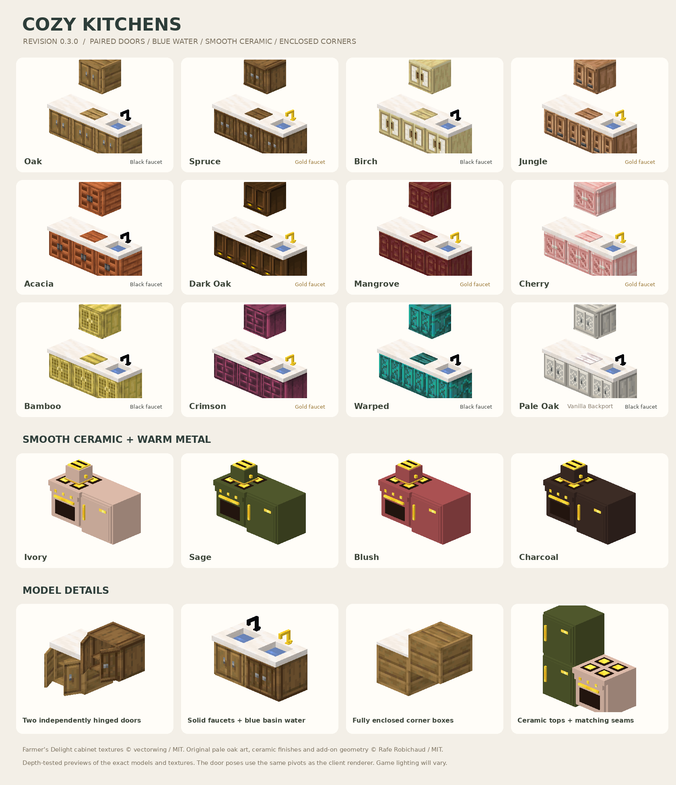
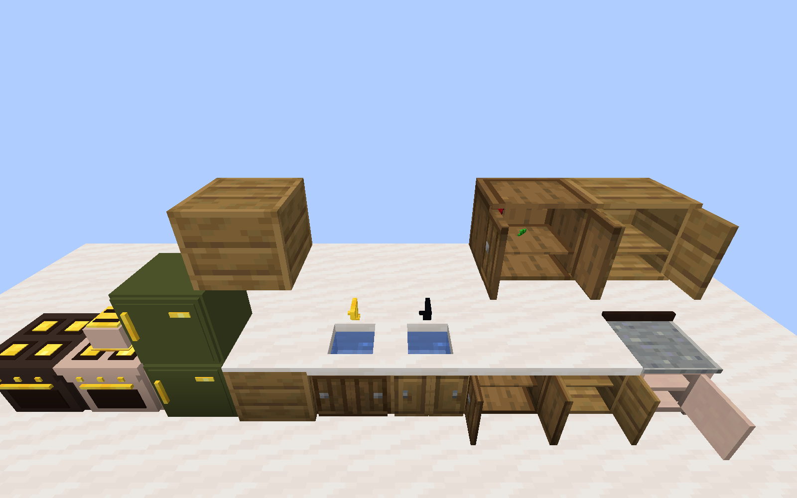

# Cozy Kitchens for Blockheads

[](https://github.com/JasperPepper25/Cozy-Kitchens-for-Blockheads/actions/workflows/build.yml)


[](LICENSE)

Functional kitchens with a cabinet design for every wood, quartz worktops, white ceramic sinks, gold or black faucets, and coordinated smooth ceramic appliances. Powered by **Cooking for Blockheads** on **Minecraft 1.20.1 / Forge**.

[Download 0.3.0](releases/0.3.0/cozy-kitchens-forge-1.20.1-0.3.0.jar?raw=true) · [Installation and crafting](docs/INSTALL.md) · [Report an issue](https://github.com/JasperPepper25/Cozy-Kitchens-for-Blockheads/issues/new/choose) · [Changelog](CHANGELOG.md)



## Rendering update in 0.3.0

Blue sink water, complete solid faucets, fully enclosed corners, paired cabinet doors, and corrected overlapping surfaces on counters and ovens. The original appliance colors now use smooth ceramic textures; refrigerator tops and stacking seams match the chosen finish. Existing wood art, recipes and stored kitchen data are retained.



[Open cabinet interiors](docs/screenshots/cozy-0.3.0-open.png) · [Enclosed corners from behind](docs/screenshots/cozy-0.3.0-corners-rear.png) · [Oven backs](docs/screenshots/cozy-0.3.0-ovens-rear.png) · [Stacked refrigerator](docs/screenshots/cozy-0.3.0-fridge.png). These are unedited Minecraft client captures from the disposable test world, using night vision for inspection lighting and no shaders.

## Kitchen sets

Each of **oak, spruce, birch, jungle, acacia, dark oak, mangrove, cherry, bamboo, crimson, warped, and pale oak** has:

- Kitchen counter and wall cabinet
- Cooking table and sink
- Kitchen corner and hanging corner

Eleven wood sets use credited **Farmer's Delight** cabinet artwork. Pale oak has original lattice doors, framed side panels, and bordered top/bottom panels. Pale oak requires **Vanilla Backport**.

**Ivory, sage, blush, and charcoal** each include an oven, refrigerator, and toaster. There are **84 blocks with Backport**, or **78 without it**. All have survival recipes.

| Faucet finish | Sink sets |
| --- | --- |
| Gold | Spruce, Jungle, Dark Oak, Mangrove, Cherry, Crimson |
| Black | Oak, Birch, Acacia, Bamboo, Warped, Pale Oak |

## Install

| Dependency | Supported version |
| --- | --- |
| Minecraft / Java | 1.20.1 / Java 17 |
| Forge | 47.2.0 or newer in the 47.x line |
| Cooking for Blockheads | **16.0.15** |
| Balm | 7.3.43 or a later 7.x version |
| Vanilla Backport + Platform | Optional; enables pale oak |

Download the [0.3.0 test build](releases/0.3.0/cozy-kitchens-forge-1.20.1-0.3.0.jar?raw=true), put it in `mods`, and install the same version on the server and every client. Replace older Cozy Kitchens JARs when updating. Pieces appear in the **Cozy Kitchens for Blockheads** tab and in JEI under `@cozykitchens`.

The current JAR and its [SHA-256 checksum](releases/0.3.0/SHA256SUMS.txt) are preserved in `releases/0.3.0/`. Fresh development builds are available as artifacts on successful [Actions runs](https://github.com/JasperPepper25/Cozy-Kitchens-for-Blockheads/actions).

Cozy Home, Cluttered, and Farmer's Delight are optional companion mods. See the [full guide](docs/INSTALL.md) for crafting, upgrades, mixed kitchens, and compatibility details.

## Survival crafting

Combine the corresponding Cooking for Blockheads piece with **one plank of the desired wood**. For appliances, use **white dye for ivory, green for sage, pink for blush, or black for charcoal**. Recipes are shapeless; another Cozy Kitchens variant of the same piece can also be refinished this way.

## Kitchen behavior

The blocks use the **native Cooking for Blockheads block entities** for storage, recipe discovery, kitchen connections, fluids, cooking, upgrades, and automation. Mix finishes and original CFB pieces in one kitchen. Counters and wall cabinets open two separate doors, one to each side; matching refrigerators stack into large refrigerators; ovens and toasters retain CFB behavior.

The version is pinned to CFB 16.0.15 because the add-on uses its internal block-entity and model APIs. The [verification notes](VERIFICATION.md) describe the checks performed and their limits. Full modpack and resource-pack validation remains an in-game task.

## Build and contribute

With a Java 17 JDK:

```sh
./gradlew clean build
```

On Windows, use `gradlew.bat clean build`. The production JAR is written to `build/libs/`. Committed resources are ready to build; the artwork tools do not need to run first.

The GitHub workflow checks the production package, model surfaces and palette; runs the six Forge kitchen integration tests; and launches the client to check meshes, texture reloads and a disposable kitchen world, both with and without Vanilla Backport. See [CONTRIBUTING.md](CONTRIBUTING.md) for test commands, asset generation, and development conventions.

## Artwork and license

Farmer's Delight's cabinet textures are **copyright (c) 2020 vectorwing**, redistributed unchanged under MIT with the [complete license](src/main/resources/META-INF/licenses/FarmersDelight-MIT.txt) and [per-file provenance](art/farmers-delight-provenance.json). Original code, geometry, ceramic textures and pale oak artwork use the root [MIT License](LICENSE).

The original appliance geometry takes artistic inspiration from Cozy Home and Cluttered. Minecraft materials are referenced at runtime. See [THIRD_PARTY_NOTICES.md](THIRD_PARTY_NOTICES.md) for credits. This is an independent add-on.
